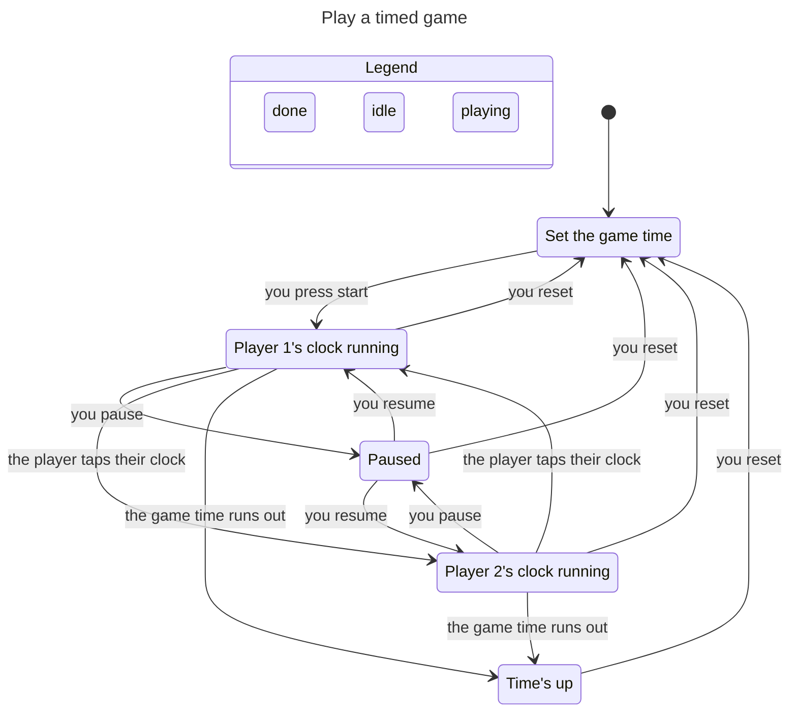

# Chess clock verification

| Skill | What it checks | Tool |
| --- | --- | --- |
| [verify-chessclock](../../.claude/skills/verify-chessclock/SKILL.md) | Player clocks add up to the game time used, the game ends at zero, and the clock is always on a real player | TLA+ / TLC, 31 states, plus `tests/test_clock.py` |

The model found three server bugs, now fixed, and the flow model below exposed a fourth in the page:

1. `/switch/3` charged time to nobody (dc3d161).
2. `/start` during a game cleared the players but kept the global time used (07857be).
3. The global time ran below zero and the game never ended (7a78940).
4. Reloading the page during a game showed an empty clock and offered to start again (9c16e5f).

## Play a timed game

Generated with pstack `/statechart` from [PlayGame.tla](flows/play-a-game/PlayGame.tla) ([TLC report](flows/play-a-game/report.md)). The chart hides seconds passing and page reloads, which leave the screen unchanged.

